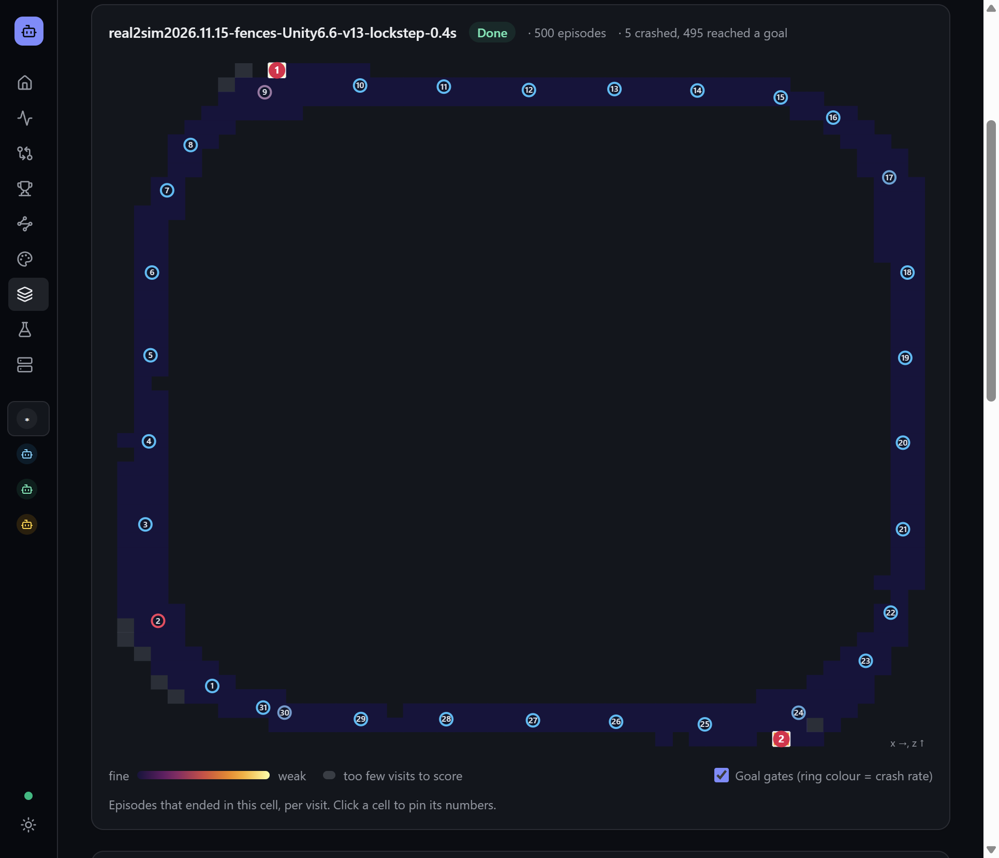

# Dashboard: architecture notes and limitations

The dashboard (`dashboard/`, compose service `dashboard` on **`node:20`**, port
80) is an Express server (`dashboard/src`) plus a React app
(`dashboard/app`, served at **`/app`**). `npm start` runs `prestart`, which does
`npm install` **only when `node_modules` is missing** and then always `tsc`, so
a container restart is a fast offline compile (after bumping the base image, do
a one-time `rm -rf node_modules && npm install` so ABI-sensitive deps rebuild).
Server changes need a **dashboard container restart**; app changes need
`cd dashboard/app; npm run build` and a browser reload.

The app's pages: Home, Runs (queue, launch, per-run curves, logs and media),
Compare, Models (and the leaderboard), Curricula, Design (gyms, reward and
experiment designs, demos), Insights, Lab (MadScientist) and System. The old
Golden Layout pages are gone; their URLs (`/`, `/jobs`, `/logs`, `/weakness`,
`/madscientist`, `/models`, `/analysis`, ...) redirect to the matching `/app`
page.

A few architectural points are worth knowing:

- **Two APIs.** The app reads typed routes under **`/api/v1`**
  (`dashboard/src/api/*.ts`: runs, queue, launch, metrics, compare, models,
  curricula, designs, lab, insights, system) and a live WebSocket at
  `/api/v1/live` for run updates. Design, gym, demo and curriculum *writes*
  still go through the classic routes in `server.ts` (`/add_*`, `/update_*`,
  `/archive_*`), which validate and lint; the app calls them directly. The MCP
  console (`mcp/console`) uses `/api/v1` for the queue, logs, weakness analysis,
  MadScientist and model promotion, and the classic routes for the rest.
- **What the server can't see.** The container mounts only `./dashboard`,
  `./rl_agent`, `./robots`, `../saved_models` and the `tmpdata` volume on
  `/tmp`, with no Docker socket. Unity client processes, local gym builds and
  release uploads are therefore handled by MCP tools that run on the Windows
  host (`get_unity_clients`, `set_unity_clients`, `list_gym_builds`,
  `package_gym`, `add_gym_to_release`). The System page shows what the server
  can see: worker heartbeats, the queue, disk space, Mongo, the gym each Unity
  supervisor is told to run, GitHub releases (set `GITHUB_TOKEN` for a private
  repo), and the workers' shared logs on `/tmp`.
- **Crash resilience.** The server installs process-level `uncaughtException` /
  `unhandledRejection` guards, and every Mongo request handler responds with a
  `500` instead of `throw err`. A single transient Mongo error (a change-stream
  reconnect, replica-set blip, connection reset) used to terminate the process
  and bounce the container. The startup `MongoClient.connect` retries with
  backoff instead of throwing, so there is no boot crash-loop if mongo lags.
- **Change-gated classic GETs.** The classic list routes (`/get_jobs`,
  `/get_models`, `/get_experiment_designs`, ...) are gated by
  `needsUpdate(req, res, changed, coll)`. A MongoDB change stream
  (`superviseChangeStream`, which needs Mongo to be a replica set and recreates
  dead streams with backoff) bumps a per-collection version on every write,
  returned as the **`X-Coll-Version`** header. `?since=<version>` answers
  `NO_CHANGES` unless the caller is behind; `?force=true` always sends. These
  routes return the whole collection; the `/api/v1` equivalents paginate.
- **Weakness analysis** (`dashboard/src/api/weakness.ts`) reads the segment-end
  trajectory logs (`logs.position_history`) of a car run's most recent
  episodes. The grid view scores cells by crash rate, slowness and pre-crash
  risk and groups weak cells into hotspots. The gate view ranks goal gates by
  crash rate (95% Wilson ranges, shrunk toward the track average) and proposes
  a start-gate distribution aimed at the hard ones. The trainer can't apply
  that distribution yet: Unity picks a uniformly random start gate on every
  reset. The gate statistics take several seconds on a long run because they
  scan `position_history` strings.
- **`/add_job` inserts `req.body` verbatim** with no server-side schema
  validation, so typos in field names fail silently (the trainer falls back to
  defaults). The app and the MCP console build jobs through `POST /api/v1/runs`
  and `jobPayload.js`, which do validate.
- **Eval modal stage source.** The Models page's eval "curriculum sweep" start
  and end stages come from the **selected model's experiment-design
  `curriculum_stages`**; gym docs carry no stage data.
- **MadScientist decisions don't wake the orchestrator.** Approving sets
  `status=approved`; the Python worker picks it up on its next poll. Email
  magic links (`/madscientist/act?token=...`) still land on the server, and its
  "Open the dashboard" button goes to `/app/lab`.
