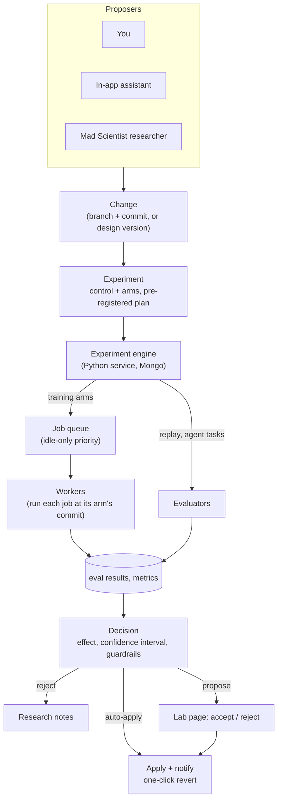

# Self-improvement loop: experiments for every kind of change

Status: **plan, not built**. Phase 2 of the in-app assistant work (phase 1, the
chat panel and agent bridge in `agent/`, is done).

## Goal

A loop that improves the lab with evidence rather than opinion:

1. A change is proposed: by you, the in-app assistant, or the Mad Scientist.
2. It is built on a branch, or as a new design version.
3. An experiment compares it with the current version (the control), and
   optionally with other variants, on metrics fixed before it runs.
4. The result is one of three:
   - **Rejected:** no real improvement. The result is still recorded so the
     same idea isn't retried blindly.
   - **Proposed:** an improvement you accept or reject.
   - **Applied automatically:** a large, clear improvement to a kind of change
     allowed to auto-apply. You are notified and can revert in one click.

Two priorities sit beside the loop itself. One is code changes that make new
robots, and their robot-specific needs, easy to add. The other is skills, the
written procedures the assistant follows, for that and for the loop's other
recurring jobs.

## Decisions already made

| Decision | Choice |
|---|---|
| Changes that may auto-apply | Reward, curriculum and experiment **design versions**, and **skills**. Metrics, robot code and UI changes are always proposed. |
| GPU time for automated experiments | Only when the job queue is otherwise idle. Your jobs always go first. |
| First build | The experiment engine with design and training arms, plus robot extension points. |
| Model provider | Anthropic API (`ANTHROPIC_API_KEY`), as for the bridge and the Mad Scientist. No Cursor dependency. |
| Where code edits happen | A git worktree and branch per session, never the live checkout. |
| How accepted code reaches `main` | As a GitHub pull request in the lab repo, `frenb/rl-robotlab` (`LAB_REPO`, see "Code changes become pull requests"). Nothing in git is changed on `main` directly. |

## What exists to build on

- **The Mad Scientist** (`rl_agent/madscientist/`) has the proposal life cycle
  that runs the loop. A researcher writes proposals with `experiment_arms` and
  `success_criteria`, a judge scores them against a rubric, and the user
  decides through the dashboard Lab page or email. The orchestrator queues
  arms × seeds as TRAIN jobs, and the outcome ingester turns finished jobs
  into verdicts. Limits: arms only vary the car's experiment-design settings,
  and the code-change path depends on Cursor and has never run end to end
  (see `madscientist-autonomous-codegen.md`).
- **Statistics:** `/api/v1` arm stats with `n_trials`, mean, median, standard
  deviation and a 95% confidence interval, and `compare_models` with Welch's
  t-test.
- **Curricula** (`rl_agent/curriculum/`): stages, gates on eval metrics,
  versioned definitions, and a run copy that each run keeps.
- **Design versioning:** reward and experiment designs are versioned, and jobs
  record the version they used.
- **Robot manifests** (`robots/<id>/robot.yaml`): engine, supported features,
  job types, curriculum carry rules, gate metrics and stage settings.
- **The agent bridge** (`agent/`): an Anthropic loop over the 68 console MCP
  tools, with approval cards for anything that isn't read-only, and a chat
  panel on every app page. `review_media` lets it look at clips.

## Architecture



- **Experiment engine:** a new Python service next to the curriculum runner
  (`rl_agent/experiments/`). It reads and writes Mongo and queues jobs through
  the existing queue. It computes nothing on the GPU itself.
- **Code-writing** stays in the host-side agent bridge, because it needs git
  worktrees, builds and docker on the host.
- **Applying** a change is done by a host-side applier. It runs in the bridge
  at first and can become its own watcher later.

## Data model

### `experiments` collection

```text
_id, title, robot, kind            # kind: design | robot_code | metric | ux | skill | skill_meta
hypothesis                         # one sentence, written before running
control:  { label, change }
arms:     [{ label, change }]      # 1..N
change:   { git_sha?, branch?, reward_design?: {id, version}, curriculum?: {id, version},
            experiment_design?: {id, version}, skill?: {name, version}, metric?: {name, version},
            stage_settings?: {...}, gym?, init_checkpoint? }
plan:                               # fixed before the first job is queued
  primary_metric, direction         # e.g. jump_landing_rate, higher
  min_effect                        # smallest change that counts, in metric units
  auto_threshold                    # min_effect for auto-apply (lower CI bound must clear it)
  guardrails: [{ metric, max_regression }]
  seeds, eval_trials, budget_updates, early_stop
  evaluator                         # train_eval | replay | agent_tasks | skill_bench
status:  draft -> queued -> running -> analyzing -> rejected | proposed | applied | reverted | failed
         # changes in git: proposed -> accepted -> pr_open -> merged -> deployed  (or pr_closed)
pr:      { repo, number, url, branch, head_sha, state, checks, merged_sha?, opened_at, merged_at? }
jobs:    [{ arm, seed, job_id, role }]
results: { per_arm: {...stats}, effects: [{ arm, delta, ci_low, ci_high, p }], guardrails: [...] }
decision: { verdict, reason, decided_by: auto|user, at }
apply:   { actions: [...], revert: [...], applied_sha?, notified_at? }
origin:  { by: user|assistant|madscientist, proposal_id?, session_id? }
```

The Mad Scientist's `proposals` keep their research and judge role. An
approved proposal creates an experiment, and the experiment's outcome flows
back into the proposal and its research notes.

### Re-using control results

Training is expensive, so a control arm whose change matches a finished run
can reuse that run's eval results instead of retraining. A match means the
same commit, design versions, gym, stage settings and seed count. The engine
looks for matches before queueing.

## Running arms at different code versions

The trainers run straight from the bind-mounted `rl_agent/` folder, so today
every job runs whatever is checked out.

- Jobs get a `code_ref` (git sha). The MuJoCo-based workers (MicroDuck,
  OpenBeni) already start training as a separate process
  (`mjlab_core/worker.py`, `python <train_entry>` with a working folder). For a
  job with a `code_ref`, the worker:
  1. creates or reuses `/shared_tmp/worktrees/<sha>` (`git worktree add`);
  2. runs the trainer from there, with `PYTHONPATH` pointing at the
     worktree's `rl_agent`.
- Third-party robot packages installed in the image (for example `beni_rl`)
  have to come from the worktree too: put the worktree's
  `third_party/<robot>/python` first on `PYTHONPATH`. Changes to Python
  dependencies are out of scope for experiment arms: they need an image rebuild.
- The car trainer runs everything in one process, so car arms that change code
  run one at a time on a restarted trainer, or wait for a later phase.
  Design-only car arms work immediately.
- Each job records the sha it ran, so a result can always be traced to its code.

## Evaluators, by kind of change

| Kind | Evaluator | Primary metrics | Guardrails |
|---|---|---|---|
| Reward, curriculum, experiment design | `train_eval`: each arm × seeds trains, then is evaluated with a fixed number of trials | the robot's gate metrics (for example `fall_rate`, `jump_landing_rate`, the car's score) | time to reach the gate, other gate metrics |
| Robot integration code | Automated tests first; then `train_eval` on a short budget against that robot's baseline | the baseline's main metric | tests, export still works, clip and eval jobs still run |
| New metric | `replay`: re-score finished models and evals; no training | separates known good and bad models; steady across seeds (low spread for the same model); agrees with your labels where you've given them | cost to compute |
| UI change | `agent_tasks`: the assistant does scripted tasks in a browser on each arm's preview build | task success, steps, time | screenshot diffs on key pages, accessibility check, build size |
| Skill | `skill_bench`: run the assistant on the skill's benchmark cases with version A, then B | share of cases passing automated checks; downstream metric where there is one | tokens and time per case |
| Skill for improving skills | `skill_bench` one level up | average gain it produces on other skills' benchmarks | — |

UI changes and metrics are always proposed, never auto-applied. For UI, an
experiment can also show you both versions side by side and record your pick
as a preference result.

## Deciding

Fixed before the first job runs:

1. **Effect:** each arm minus the control on the primary metric, with a 95%
   confidence interval: Welch's t-test across seeds, or a bootstrap when there
   are few seeds.
2. **Verdict:**
   - **Rejected:** the interval includes zero, or the improvement is below
     `min_effect`.
   - **Proposed:** the lower end of the interval clears `min_effect`, and every
     guardrail is within its allowed regression.
   - **Auto-apply:** proposed, and the lower end also clears `auto_threshold`,
     and the kind is allowed to auto-apply (design versions, skills), and
     nothing is training on the parts it changes.
3. **More than one arm:** the threshold for each comparison with the control
   is adjusted (Holm), so running many arms doesn't create false wins.
4. **Early stopping:** budget checkpoints (for example 25%, 50%, 100%) drop
   arms that are clearly worse. Arms are never promoted early.

Thresholds per robot and kind live in `robot.yaml` under `experiments:`, with
global defaults. They are deliberately left to be decided per metric.

## Applying and reverting

| Kind | Apply | Revert |
|---|---|---|
| Design version | Make it the default for its gym or curriculum; future jobs use it | Restore the previous default |
| Skill | Open a pull request for the new version with auto-merge on green checks | A revert pull request |
| Code (robot, metric, UI) | Open a pull request when you accept; deploy after you merge it | A revert pull request, then deploy |

Every apply records its revert actions before it runs.

### Code changes become pull requests

When you accept a change that lives in git (robot integration code, a metric,
a UI change, a skill), the applier opens a pull request in the lab repo
instead of merging anything itself. Importing a new robot is the typical case:
the import's code is proven by its experiment, and accepting it opens one
pull request with the robot's folder, manifest and any shared-code changes.

1. **Accept** on the Lab page (or in chat), or auto-apply for a skill.
2. **Push** the arm's worktree branch to `LAB_REPO` as
   `lab/<experiment id>/<slug>`, rebased on the current `main`. A rebase
   conflict stops here and marks the experiment `pr_conflict` with the files
   involved, so the assistant can rework it.
3. **Open the pull request** through the GitHub REST API with `GITHUB_TOKEN`
   from `.env`, or the host's `gh` login. No Cursor dependency.
   - Title: the experiment title.
   - Body: hypothesis, arms, the results table with confidence intervals,
     guardrails, links to the experiment, run and compare pages, test results,
     and the revert plan.
   - Labels: `lab`, `kind:<kind>`, `robot:<id>`.
   - Skills only: auto-merge turned on, so the pull request merges when its
     checks pass.
4. **Track** it. A watcher polls open lab pull requests and mirrors their
   state (checks, review, merged or closed) onto the experiment and the Lab
   page, which links to the pull request.
5. **Deploy** after merge. Once training is idle, the host pulls `main`,
   rebuilds the app or images if their files changed, and restarts the
   affected services, then marks the experiment `deployed` with the merged
   sha. This is the deploy watcher from `madscientist-autonomous-codegen.md`
   phase 1.
6. **Closed without merging:** the experiment becomes `pr_closed` and nothing
   is applied; the branch is kept for reference.

The pull request is the record of every code change the loop makes. A
required check runs the tests and refuses changes to the forbidden paths (the
experiment engine, the applier, the deploy watcher, secrets). Auto-applies send a
notification (the Lab page and email, through the Mad Scientist's
`email_bridge`) with the evidence and a revert link. Nothing restarts while a
job is running.

## Robot extension points (first priority)

The OpenBeni jump work (Nov 21) needed stage settings, a clip-renderer change,
a status reader and a run-page row, and each landed in shared code. Make these
standard slots that a robot fills in:

| Slot | Where | Status |
|---|---|---|
| Stage settings | `robot.yaml` `curriculum.stage_settings`, applied by `mjlab_core/stage_settings.py` | exists; split per-robot keys into robot-owned handlers |
| Gate metrics | `robot.yaml` `curriculum.gate_metrics`, computed by the robot's eval hook | exists |
| Metric plugins | `rl_agent/<robot>/metrics.py` registering named metrics computed from eval rollouts or run files | new |
| Clip director | `director(raw_env, checkpoint)` in `rl_agent/<robot>/` | exists |
| Run status readers | a per-robot reader on the server (for example OpenBeni's jump status) behind a generic `robot_status` field | new; move `jumpStatus` there |
| UI panels | `dashboard/app/src/robots/<id>/`, registered by slot (run-page rows and tabs, model cards, launch fields), declared in `robot.yaml` `ui:` | new |
| Worker hooks | `rl_agent/<robot>/hooks.py`: before and after training, extra job types | partly (`cfg_hook.py`) |

An importer adds a folder with these files and a manifest; the shared pages
read the manifest and never name a robot.

## Skills

Skills live in `skills/<name>/SKILL.md` in the repo, are versioned in git, and
are loaded by the agent bridge (and readable by Cursor). Each has a
`bench/` folder of cases: a starting state, a request, and automated checks.

First set:

| Skill | Benchmark cases check |
|---|---|
| `import-robot` | manifest validates; tasks register; a short training run starts, exports and records clips |
| `develop-curriculum` | curriculum validates; stages warm-start; gates use available metrics |
| `design-reward` | design lints; a short run trains without NaNs; it changes the intended terms only |
| `change-ui` | type check and build pass; scripted browser task succeeds |
| `create-metric` | the metric registers, computes on stored evals, and passes the replay checks |
| `create-skill`, `improve-skill` | the new or edited skill's own benchmark score |

## Phases

### Phase 2a: experiment engine for design arms

- `rl_agent/experiments/`: the data model, the engine loop, the `train_eval`
  evaluator, statistics, the decision rules and control reuse.
- The queue gets an `idle-only` priority for experiment jobs.
- MCP tools: `create_experiment`, `list_experiments`, `get_experiment`,
  `decide_experiment`, `revert_experiment`.
- App: an Experiments view in the Lab page, with arms, effect and confidence
  interval charts, guardrails, and accept, reject and revert buttons.
- Applying and auto-applying for design versions.

Acceptance:
- An experiment with two OpenBeni curriculum arms (for example
  `jump_start_by_update` 1 against 9000) runs on a short budget, produces a
  verdict with a confidence interval, and applies or proposes correctly.
- A guardrail regression blocks the apply.
- Control reuse skips retraining when a matching run exists.

### Phase 2b: robot extension points

- Metric plugins, run status readers, UI panel slots and worker hooks, with
  OpenBeni moved onto them (jump status, the clip director, stage settings) as
  the proof.
- `code_ref` jobs: the per-commit worktree runner for the MuJoCo-based workers.

Acceptance:
- OpenBeni's jump-specific code lives only under its robot folders, and the
  shared pages and worker name no robot.
- Two arms at different commits train at the same time and record their sha.

### Phase 2c: workspace tools and branch preview in the bridge

- File, search, edit and command tools (allowlisted, repo-scoped, `.env` and
  secrets blocked), a worktree per session, and a preview Vite server.
- Accepting a change opens a pull request in `LAB_REPO`; the pull request
  watcher, the deploy-after-merge step, and revert pull requests.
- A required GitHub check: tests plus the forbidden-path check.
- Guardrails: a bridge access token and a monthly spend cap.

Acceptance:
- From the chat, a UI change is made on a branch and previewed. Accepting it
  opens a pull request with the evidence in its body. Merging it on GitHub
  deploys it once idle. A revert pull request undoes it. `/app` is never broken.

### Phase 2d: skills and skill benchmarks

- The skill registry and runner (`skill_bench`), the first skill set and their
  cases, and auto-apply for skills.

Acceptance:
- An `improve-skill` run on `design-reward` produces a new version whose
  benchmark score is measured against the old one, and it is applied or
  rejected by the decision rules.

### Phase 2e: metric and UI evaluators

- The `replay` evaluator for metrics, and the `agent_tasks` evaluator with
  scripted browser tasks, screenshot diffs and side-by-side preference.

Acceptance:
- A new metric is checked on stored evals and proposed with its evidence.
- A UI change is compared on scripted tasks and proposed.

### Phase 2f: connect the Mad Scientist

- Approved proposals create experiments; outcomes and verdicts feed research
  notes; the researcher can propose any kind of change, not just car settings.

## Risks

- **GPU time.** OpenBeni runs at about 10 s per update; a 3-arm × 3-seed
  experiment can take days on one machine. Mitigations: idle-only scheduling,
  short proxy budgets before full runs, early stopping, control reuse. Remote
  GPUs (robot-ingestion plan phases R2 and R3) would help most.
- **Noisy metrics with few seeds.** Pre-registered thresholds and adjusting for
  multiple arms keep false wins down; some changes will need more seeds than
  the budget allows and should come back as "not enough evidence".
- **Auto-applied skills changing behaviour broadly.** A skill's benchmark only
  covers its cases. Keep the cases growing from real sessions, and record each
  skill version in every session that uses it.
- **Self-modification breaking the loop.** Code changes always go through a
  branch, tests and preview; the experiment engine and the applier are on the
  forbidden list for automatic edits.

## Open questions

- `min_effect` and `auto_threshold` per metric and robot.
- How many seeds a design experiment needs before it can auto-apply.
- Whether experiments may use remote GPUs, and with what spend cap.
- Which scripted UI tasks make up the first UI benchmark.
